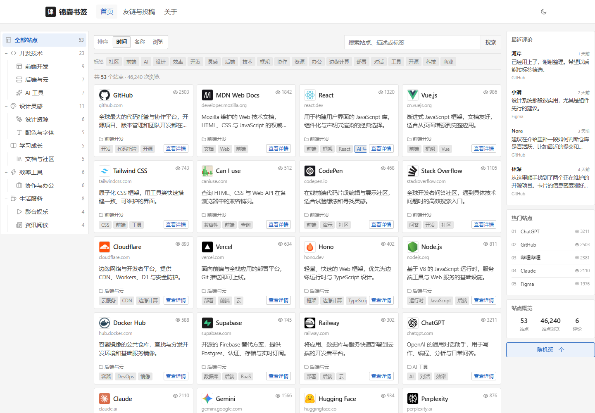
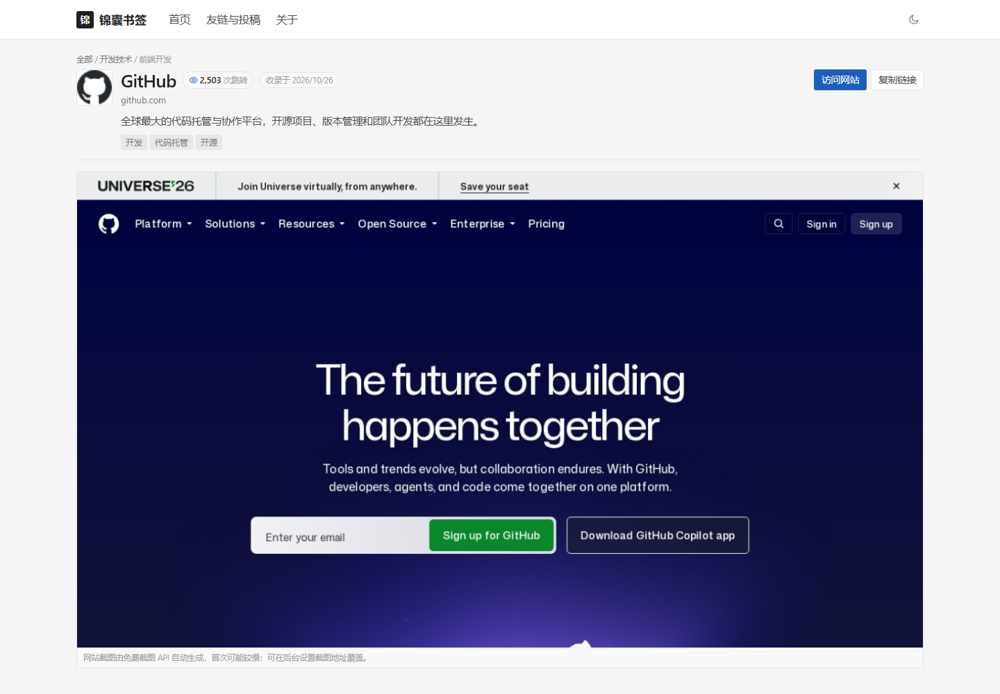
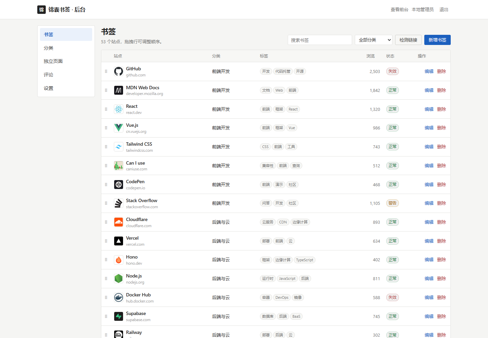
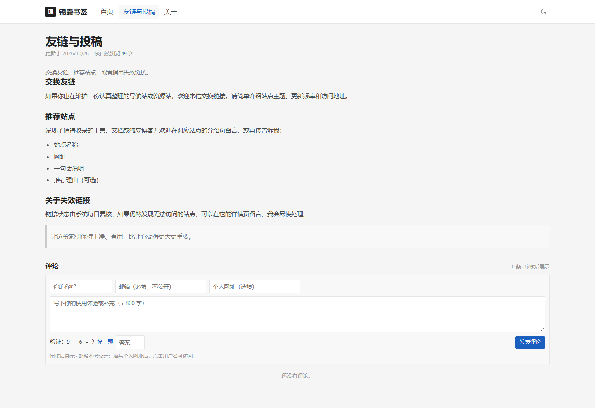
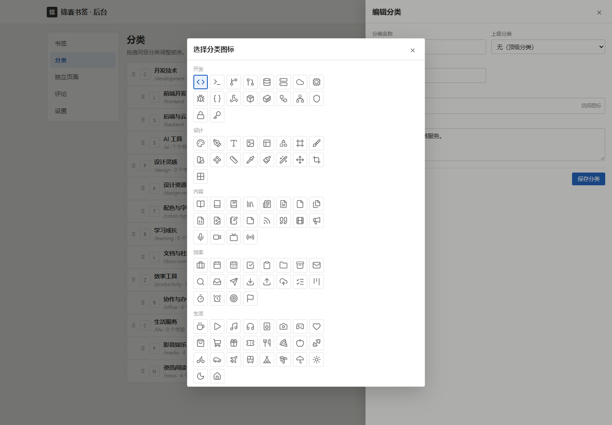

# 锦囊书签 · iNav

一款极简网址导航站，可完整部署在 **Cloudflare Workers + D1 SQLite** 上，也可以在本地用 Wrangler 完整运行和测试。

公众前台和后台都是**无框架的原生 TypeScript 应用**，首屏资源很小，后台只在访问 `/admin` 时加载。本项目的分类、站点、页面、评论、统计和检测数据都存放在 D1 中。



## 功能

### 前台

- 左侧多级分类树，支持折叠和**分类图标**；父分类包含所有子分类站点。
- 右侧固定卡片布局，展示图标、名称、整行域名、简介、标签与跳转次数；不记录单独的点击次数。
- 浏览量位于卡片右上角；“查看详情”放在卡片右下角。
- 卡片底部没有横向分隔条；全部站点视图下，分类以文件夹图标链接显示在标签上方，点击即可进入对应分类。
- 简介始终显示两行；当内容被截断时，鼠标停留在卡片上会显示 Windows 原生提示框，内容为完整描述。
- 卡片有边框高亮、背景变成浅蓝色的 hover 动作。
- 分类内按 **时间 / 名称 / 浏览量** 排序；桌面排序框在左侧，移动端居中显示“排序：”和三个胶囊按钮。
- 标签与“查看详情”强制显示在一行；标签超出时，桌面 hover 卡片以 2.5 秒往返轮播全部标签，触屏可横向滑动。
- 点击卡片上的标签会跳转到对应标签筛选。
- 移动端分类按钮为右下角小号悬浮按钮；品牌和导航居中，深色/浅色图标位于顶部右侧；页脚链接右对齐。
- 宽屏首页右侧为粘性动态栏：最近评论、热门站点、站点概览和“随机逛一个”；间距、内边距与字号按左栏比例统一。较窄屏幕为保证卡片尺寸会自动隐藏右栏。
- 图标优先使用手填地址，否则由 **Google gstatic CN** 读取；失败时显示站点首字母。
- 没有手填简介时，调用当前 AI 配置生成。
- 每个站点都有独立页面，展示：
  - Markdown 介绍；
  - **由截图 API 自动获取的网站截图**（也支持后台手填截图地址覆盖；失败时自动尝试备用截图服务）；
  - 浏览数据、同分类推荐；
  - 独立评论。
- 所有卡片都显示右下角「查看详情」按钮；所有可见站点都有独立详情页。
- 前台不展示网站链接在线状态，链接检测结果只保留在后台。
- 前台不显示后台管理入口；后台仍可通过 `/admin` 直接访问。
- 独立关于页；后台还可以创建任意数量的 Markdown 独立页面。
- 站点卡片和详情页直接打开原站，不再经过中间跳转；跳转时通过 `keepalive` 请求异步累加站点浏览数。旧 `/go/:id` 仅保留兼容。
- 页面访问流水存入 `page_views`，仅用于今日访问统计；站点浏览量为外链跳转总和，独立页面另有自己的访问计数。
- 链接健康结果（状态、HTTP 码、耗时、检测时间）写回 D1，并保留历史记录。

### 评论

- 站点详情页和后台创建的独立页面都支持评论，后台统一审核。
- 评论必须填写称呼、邮箱、内容；个人网址选填。邮箱只进入后台，不公开。
- 填写个人网址后，评论用户名会变成可点击链接；评论时间和最近评论都支持定位到对应评论。
- 数学验证码：HMAC 签名 token，10 分钟过期。
- 蜜罐字段、最短提交时间、2 小时表单有效期。
- 同 IP 摘要 10 分钟最多 3 条、24 小时最多 15 条；内容去重。
- 屏蔽词、链接数量限制、重复字符检测。
- 可配置审核后发布；后台支持通过、标记垃圾、恢复、删除。
- IP 只保存不可逆摘要，不公开。

### 后台

- GitHub OAuth 登录；管理员名单 = 环境变量 + 后台设置。
- 本地开发可启用仅 development 生效的快捷登录。
- 无框架原生 TypeScript 后台，左侧只保留“书签 / 分类 / 独立页面 / 评论 / 设置”五个标签，不再显示描述小字。
- 后台品牌名跟随“设置 → 站点名称”实时变化。
- 无概览页；链接检测按钮放在书签页顶部。
- 书签列表显示真实站点图标、分类筛选、全部标签列；状态徽章可点击重新校验单个站点。
- 站点增删改查、分类增删改查（含层级移动、循环校验）、详情 Markdown；编辑使用单一右侧抽屉，不再叠多层弹窗。
- 书签标签使用胶囊编辑器：已有标签可直接点选，新标签回车或“添加”加入，已选标签只能删除。
- 书签详情支持 Markdown 预览；分类图标改为点击分组图标网格选择，不再手填图标名。
- 分类图标使用下载到项目内的 Lucide 图标精灵（130 个，按开发/设计/内容/效率/生活/通用分组），点击弹出图标选择窗口，运行时不访问图标 CDN。
- 书签编辑表单不再放“前台显示/启用详情页”开关；新增站点默认显示并启用详情，编辑时保留原状态。
- **拖拽排序**：书签、同级分类、独立页面均通过拖拽保存顺序，编辑表单中不再出现排序值。
- **独立页面管理**：标题、路径、摘要、Markdown 正文、发布状态、是否显示在顶部导航；“关于”固定在导航最后。
- 站点截图地址手动覆盖。
- AI 简介生成/重新生成；支持 Pollinations（免费）、OpenAI 兼容、DeepSeek、Gemini。
- 评论审核、批量链接检测；最近检测记录和历史仍保存在 D1。
- 站点信息、关于页面、SEO、评论策略、屏蔽词、AI 模型与管理员设置。
- 删除点击次数与概览统计；后台只保留书签浏览量和独立页面访问量。



<p align="center">
  
</p>

<p align="center">
  
</p>

<p align="center">
  
</p>

<p align="center">
  
</p>

## 轻量策略

| 项目 | 体积 |
| --- | --- |
| 公众前台 JS（含 Markdown 渲染） | 约 33 KB，gzip 约 12 KB |
| 公众前台 CSS | 约 23 KB，gzip 约 5.3 KB |
| 管理后台 JS（原生 TS） | 约 34 KB，gzip 约 9.8 KB |
| 管理后台 CSS | 约 17 KB，gzip 约 3.8 KB |
| 本地分类图标精灵 | `public/category-icons.svg`，约 44 KB / 130 个 |
| 运行时依赖 | 无 React、无前端框架、无图标库、无 Markdown 第三方库 |

- 公众前台用原生 TypeScript + History API 实现，没有运行时框架。
- 分类图标使用项目内的 Lucide 图标精灵 `public/category-icons.svg`（130 个），按需加载一次，不访问图标 CDN；许可证见 `public/category-icons.LICENSE.txt`。
- Markdown 使用一个约 4.3 KB 的安全子集渲染器，先转义 HTML 再处理标题、列表、引用、代码、链接、粗体与斜体。
- 管理后台使用同一套原生 TypeScript 和 DOM 工具，构建为独立 HTML 与独立 JS/CSS，不影响前台访客。
- 站点跳转使用轻量 `fetch(..., { keepalive: true })` 上报，不阻塞外链打开；不再维护单独的点击次数。

## 技术栈

| 层 | 选择 |
| --- | --- |
| 公众前台 | 原生 TypeScript + 手写 History 路由 + 原生 DOM |
| 管理后台 | 原生 TypeScript + 原生 DOM（独立 `admin.html` 入口） |
| 分类图标 | 本地 Lucide SVG 精灵（ISC License） |
| 构建 | Vite 多入口 |
| 后端 | Hono，运行于 Cloudflare Workers |
| 数据库 | Cloudflare D1（SQLite） |
| 静态资源 | Workers Static Assets（SPA fallback） |
| 会话 | HMAC-SHA256 签名 HttpOnly Cookie |
| 定时任务 | Workers Cron Trigger |
| Markdown | 项目内置安全渲染器 |

## 目录结构

```text
.
├── index.html              # 公众前台入口（原生 TS）
├── admin.html              # 管理后台入口（原生 TS）
├── src/
│   ├── public/             # 无框架公众前台：路由、页面、评论、原生 CSS
│   ├── admin/main.ts       # 无框架后台：登录、标签、抽屉表单、拖拽排序
│   ├── lib/markdown.ts     # 前后台共用的安全 Markdown 渲染器
│   └── styles.css          # 后台样式
├── worker/                 # Cloudflare Worker API
│   ├── index.ts            # Hono 入口、/go、/admin、Cron、sitemap
│   ├── public.ts           # 导航、详情、独立页面、评论、验证码、浏览
│   ├── admin.ts            # 站点/分类/页面/评论/设置
│   ├── auth.ts             # GitHub OAuth 与签名会话
│   ├── ai.ts               # 四种 AI 简介生成
│   ├── linkcheck.ts        # 链接检测
│   ├── captcha.ts          # 数学验证码
│   └── utils.ts
├── shared/types.ts
├── migrations/
│   ├── 0001_init.sql
│   ├── 0002_pages_and_screenshots.sql
│   ├── 0003_brand.sql
│   ├── 0004_all_site_details.sql
│   ├── 0005_comment_targets.sql
│   ├── 0006_about_comments.sql
│   ├── 0007_view_semantics.sql
│   ├── 0008_remove_clicks.sql
│   └── 0009_drop_redundant.sql
├── scripts/
│   ├── seed.sql
│   └── smoke-api.mjs
├── public/                 # _headers、favicon、robots、category-icons.svg、theme-init.js
├── docs/                   # README 截图
└── wrangler.jsonc
```

## 本地运行

环境要求：Node.js `22.12+`、npm。

```bash
npm install

# 1. 本地 D1 迁移 + 演示数据
npm run setup

# 2. 构建前后台并启动 Workers
npm run dev
```

打开：

- 前台：<http://127.0.0.1:8787>
- 后台：<http://127.0.0.1:8787/admin>（使用 GitHub OAuth 登录）
- API 健康检查：<http://127.0.0.1:8787/api/health>

后台登录只支持 GitHub OAuth。先在本地创建不被提交的 `.dev.vars`：

```dotenv
SESSION_SECRET=至少16位随机字符串
GITHUB_CLIENT_ID=...
GITHUB_CLIENT_SECRET=...
ADMIN_GITHUB_LOGINS=你的GitHub用户名
SITE_URL=http://127.0.0.1:8787
```

然后在 GitHub OAuth App 中把回调地址设为
`http://127.0.0.1:8787/api/auth/github/callback`。

本地数据保存在 `.wrangler/state`。重新初始化：

```powershell
Remove-Item -Recurse -Force .wrangler\state
npm run setup
```

### 开发模式

```bash
# 完整 Workers + D1 环境（推荐）
npm run dev

# 前台 HMR（管理后台请用 npm run dev 的 8787 地址）
npm run dev:worker
npm run dev:ui
```

> Wrangler 会在启动时读取当次构建的静态资源清单。修改并重新构建后，如果页面空白或资源 404，重启 `npm run dev` 即可。HTML 已设置为 no-cache，正常部署时只需刷新。

### 常用命令

```bash
npm run typecheck       # 前后端与 Worker 类型检查
npm run test:api        # 公开面 API 冒烟检查（需本地服务）
npm run db:migrate      # 本地 D1 迁移
npm run db:seed         # 写入演示数据（可重复执行）
npm run build           # 类型检查 + 构建 index.html/admin.html
```

## 网站截图 API

详情页截图：

1. 后台为站点填写「详情页截图地址」时，直接使用该图片；
2. 留空时使用 [WordPress mShots](https://developer.wordpress.com/docs/photon/api/#mshots) 的免费截图接口：
   `https://s0.wp.com/mshots/v1/<编码后的网址>?w=1200&h=675`；
3. 如果 mShots 加载失败，自动换用 `image.thum.io` 再试一次；
4. 两个服务都失败时，页面显示“截图暂不可用，可在后台手动填写截图地址”的占位提示。

> 详情页里的 `shot-fallback` 就是这个占位块。它不是网站内容，而是截图 API 请求失败、目标站点阻止截图或网络无法访问第三方截图服务时的兜底提示。最常见原因是截图服务被网络屏蔽、目标站点拒绝机器人访问，或该域名没有可生成的首页截图。后台填写一张可访问的截图地址即可固定使用。

截图请求由访客浏览器直接发起，不占用 Worker 内存或 CPU。免费截图服务可能首次较慢、被目标站点拦截或生成占位图。

## 独立页面

后台「页面」可以创建任意 Markdown 页面：

- 路径为 `/page/:slug`；
- 可设置摘要、是否发布、是否显示在顶部导航；顺序通过拖拽调整；
- Markdown 支持标题、列表、引用、代码块、链接、粗体、斜体；
- 原始 HTML 会被转义，不能注入脚本；
- 已发布且开启“显示在导航”的页面会自动出现在前台顶部与页脚。

## GitHub OAuth 登录

1. 打开 <https://github.com/settings/developers> 创建 OAuth App。
2. 本地开发：
   - Homepage URL: `http://127.0.0.1:8787`
   - Callback URL: `http://127.0.0.1:8787/api/auth/github/callback`
3. 将 Client ID / Client Secret 写入 `.dev.vars`，不要提交。
4. 把 GitHub 用户名加入 `ADMIN_GITHUB_LOGINS` 或后台管理员名单。
5. 线上回调改为 `https://你的域名/api/auth/github/callback`。

生产环境只使用 GitHub OAuth，不包含本地快捷登录入口。

## AI 自动简介

默认使用 **Pollinations** 免费文本接口，无需 Key；免费服务可能限流或超时。生产环境建议切换到自己的 OpenAI 兼容服务、DeepSeek 或 Gemini。

切换路径：**后台 → 设置 → AI 自动简介**。

- Provider：Pollinations / OpenAI 兼容 / DeepSeek / Gemini
- Model：服务商支持的模型 ID
- API Base URL：自建网关或兼容接口
- 新站点简介留空会自动尝试生成；失败不影响保存，可稍后重新生成
- Key 只从环境变量读取，不写入 D1，也不返回浏览器

## 环境变量

本地写在 `.dev.vars`；线上使用 Secrets / Variables。

| 变量 | 必需 | 说明 |
| --- | --- | --- |
| `SESSION_SECRET` | 是 | 至少 16 字符随机串，用于会话、验证码和 IP 摘要 |
| `SITE_URL` | 推荐 | 公开 origin，用于 sitemap、CSRF 白名单和 OAuth |
| `GITHUB_CLIENT_ID` | OAuth 必需 | GitHub OAuth App Client ID |
| `GITHUB_CLIENT_SECRET` | OAuth 必需 | GitHub OAuth App Secret |
| `GITHUB_CALLBACK_URL` | 否 | 覆盖回调地址 |
| `ADMIN_GITHUB_LOGINS` | 推荐 | 逗号分隔的管理员 GitHub 用户名 |
| `AI_API_KEY` | 按服务商 | OpenAI 兼容接口 Key |
| `AI_BASE_URL` | 否 | OpenAI 兼容接口 Base URL |
| `DEEPSEEK_API_KEY` | 按服务商 | DeepSeek Key，未设置时回退 `AI_API_KEY` |
| `GEMINI_API_KEY` | 按服务商 | Gemini Key，未设置时回退 `AI_API_KEY` |

## 链接健康检测

- 新增/修改站点后自动检测一次；
- 单站检测：后台书签列表；
- 批量检测：后台书签页顶部“检测链接”；
- Cron：每天 UTC 03:00 检测最多 40 个超过 7 天未检测的可见站点；
- HEAD 返回 4xx 时用 GET 复核，6 秒超时；
- 结果写入 `sites` 与 `link_checks`；
- 401/403/405/429 标记“受限”，404/5xx 标记“失效”。

本地手动触发 Cron：

```bash
curl "http://127.0.0.1:8787/cdn-cgi/local/scheduled"
```

## 发布到 GitHub

项目已包含 `.gitignore`，不会提交 `node_modules`、`dist`、`.wrangler`、`.dev.vars`、本地缓存或测试截图。

```bash
git init
git add .
git commit -m "Initial production-ready navigation site"
git branch -M main
git remote add origin https://github.com/<your-account>/<your-repo>.git
git push -u origin main
```

提交前确认没有 `.dev.vars`、密钥、D1 本地数据库或构建产物。

完整步骤（含空仓库创建、Token 推送、密钥自检）见 [DEPLOY.md](DEPLOY.md#1-上传到-github)。

## Cloudflare 部署

首次部署需要创建 D1、写入 `database_id` 并设置 5 个 Secret：

```bash
npx wrangler login
npx wrangler d1 create inav
# 把返回的 database_id 写入 wrangler.jsonc

npx wrangler secret put SESSION_SECRET
npx wrangler secret put SITE_URL
npx wrangler secret put GITHUB_CLIENT_ID
npx wrangler secret put GITHUB_CLIENT_SECRET
npx wrangler secret put ADMIN_GITHUB_LOGINS
# AI Key 按需：
# npx wrangler secret put AI_API_KEY

npm run db:migrate:remote
# 可选演示数据；正式站通常跳过
# npm run db:seed:remote
npm run deploy
```

部署后：

- 前台与 `/admin` 都由同一个 Worker 提供；
- `/admin` 由 Worker 返回独立的 `admin.html`，静态资源仍走 Assets；
- Cron 自动生效；
- GitHub OAuth 回调改为正式域名。

### 一键部署（push 即上线）

首次部署成功后，在 Cloudflare 控制台 **Workers & Pages → Create → Workers → Import a repository** 连接本仓库：

| 配置 | 值 |
| --- | --- |
| Build command | `npm run build` |
| Deploy command | `npx wrangler d1 migrations apply DB --remote && npx wrangler deploy` |
| Node version | `NODE_VERSION=22` |

之后每次 `git push` 都会自动迁移并部署。若不想使用 Cloudflare 的 Git 集成，仓库内也提供了 GitHub Actions 工作流 `.github/workflows/deploy.yml`，配置 `CLOUDFLARE_API_TOKEN` 与 `CLOUDFLARE_ACCOUNT_ID` 两个仓库 Secret 即可（两种方式不要同时开启，避免重复部署）。

逐项操作、自定义域名、OAuth 回调与排错见 [DEPLOY.md](DEPLOY.md)。

D1 备份：

```bash
npx wrangler d1 export inav --remote --output backup.sql
```

## 数据模型

| 表 | 用途 |
| --- | --- |
| `categories` | 多级分类、排序 |
| `sites` | 站点、标签、详情 Markdown、截图覆盖、跳转浏览量、链接状态 |
| `pages` | 后台创建的独立 Markdown 页面、页面访问次数 |
| `comments` | 站点/页面评论、邮箱、个人网址、审核、IP 摘要 |
| `link_checks` | 每次链接检测历史 |
| `page_views` | 页面浏览流水（path + 时间） |
| `settings` | 站点信息、关于页、AI、评论策略、管理员 |

迁移通过 `npm run db:migrate` / `db:migrate:remote` 应用。当前有 `0001_init` 到 `0009_drop_redundant` 九个迁移。

## API 摘要

公开：

- `GET /api/health`
- `GET /api/nav`（含 `pages` 导航信息）
- `GET /api/sites/:slug`
- `GET /api/sites/:slug/comments`
- `GET /api/recent-comments?limit=4`（首页右栏）
- `GET /api/pages/:slug`（读取时累加该页访问次数）
- `GET /api/pages/:slug/comments`
- `GET /api/captcha`
- `POST /api/sites/:slug/comments`
- `POST /api/pages/:slug/comments`
- `POST /api/sites/:id/jump`（直链跳转时站点浏览 +1）
- `POST /api/views`（仅记录页面浏览流水，不增加站点浏览）
- `GET /go/:id`（兼容旧链接：站点浏览 +1 后 302）
- `GET /sitemap.xml`

后台：

- `GET|POST /api/admin/sites`、`GET|PUT|DELETE /api/admin/sites/:id`
- `POST /api/admin/sites/:id/generate-description`
- `POST /api/admin/sites/:id/check`、`POST /api/admin/check-all`
- `GET|POST /api/admin/categories`、`PUT|DELETE /api/admin/categories/:id`
- `GET|POST /api/admin/pages`、`GET|PUT|DELETE /api/admin/pages/:id`
- `GET /api/admin/comments`、`PATCH|DELETE /api/admin/comments/:id`
- `POST /api/admin/reorder`（书签/同级分类/独立页面拖拽排序）
- `GET|PUT /api/admin/settings`

## 安全

- 管理会话：HttpOnly + SameSite=Lax + HMAC 签名 Cookie，HTTPS 自动 Secure。
- 后台仅允许 GitHub OAuth；不包含本地快捷登录或调试入口。
- 静态页和后台响应启用 CSP、HSTS、X-Frame-Options、nosniff、Referrer-Policy、Permissions-Policy 与 COOP。
- 管理写操作校验 Origin。
- GitHub OAuth 使用随机 state Cookie。
- 所有 SQL 使用参数化查询。
- 站点 URL、图标和截图地址限制为 http(s) 或站内路径，并拒绝常见内网地址。
- Markdown 渲染器先转义 HTML，再处理受支持的语法；评论和名称一律按纯文本渲染。
- 评论验证码、蜜罐、频率限制、内容去重、屏蔽词和人工审核组合使用。
- 生产环境务必设置强 `SESSION_SECRET`；后台只允许 GitHub OAuth 登录。

## 设计

- 前台采用传统导航站布局：常用浅灰底 `#f5f5f5`、白色卡片、灰色边线、深色正文、蓝色链接；卡片 hover 使用浅蓝底，标签使用更深的浅灰填充。
- 桌面卡片约 176px 高，四列（1440px 下）；简介固定显示两行，截断时由 `title` 提供完整原生提示。
- 分类固定在左侧，移动端为抽屉；右下角为悬浮分类按钮，导航链接居中。
- 顶部导航栏和站点详情页、独立页面恢复 1220px；首页三栏为 1440px，中间卡片内容宽度保持不变。
- 首页左、右栏均为 215px 且使用 `position: sticky`；右栏由多个独立白色卡片组成，互不干扰。
- 站点浏览只统计外链跳转：卡片、详情页访问按钮、域名和同分类链接每跳转一次 +1；站点详情页自身访问不再增加站点浏览。
- 站点跳转次数和“收录于”日期以同款胶囊并列显示在详情页名称右侧；独立页面访问次数显示在页面信息栏“该页被浏览 X 次”。
- 移动端品牌与导航居中，字号整体放大；卡片保持紧凑内边距但使用更大的文字，标签完整换行不裁切；排序改为“排序：”加无外框小胶囊，分类悬浮按钮缩小，页脚独立页面链接右对齐。
- 页脚版权居中，不再显示站点总数和浏览次数。
- 关于页统计改为四张独立数字卡片；“全站浏览”取所有站点跳转浏览量之和。页面背景、卡片和标签维持中性灰蓝搭配。
- AI 生成的简介在卡片和详情页标注“AI 生成”。
- 后台使用原生 TypeScript 复刻前台的中性灰蓝视觉；单层右侧抽屉编辑，无概览页、无排序值输入，标签栏只有文字标签。
- 公众前台不加载外部字体或图标库；仅站点 favicon 会请求 gstatic CN 或手填地址。

## 已知边界

- mShots 是免费第三方截图服务，可能慢、被目标站点拦截或返回占位图；可手填截图地址。
- Pollinations 免费 AI 可能限流。
- 截图 API 由访客浏览器访问，目标站点可能记录访客网络信息。
- “全站浏览”取所有站点外链跳转浏览量之和；`todayViews` 来自页面访问流水，两者口径不同。
- 站点跳转次数依赖 JavaScript；右键菜单打开、禁用 JavaScript 或 keepalive 被拦截时可能少计。需要严格逐次计数时可继续使用旧 `/go/:id`。
- mShots 失败后会自动尝试 `image.thum.io`；两者都不可用时显示截图占位。
- 部分站点会拒绝机器人检测，后台链接状态可能显示“受限”；前台不再展示链接状态。

## 致谢

- 分类图标为项目内 Lucide SVG 精灵（130 个），选择器为弹窗；站点图标使用 Google gstatic CN 或手填地址。
- 运行与数据库：Cloudflare Workers、D1。
